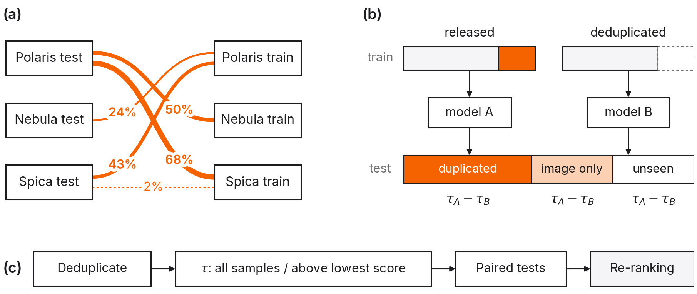
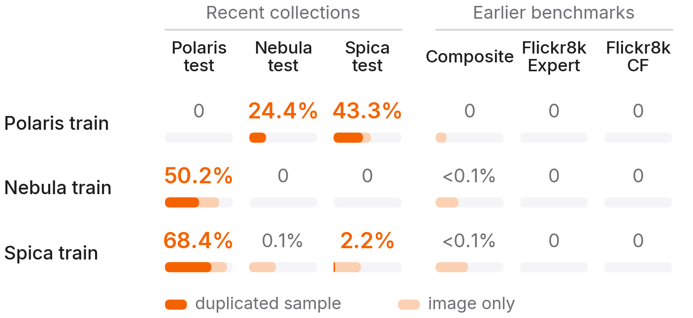
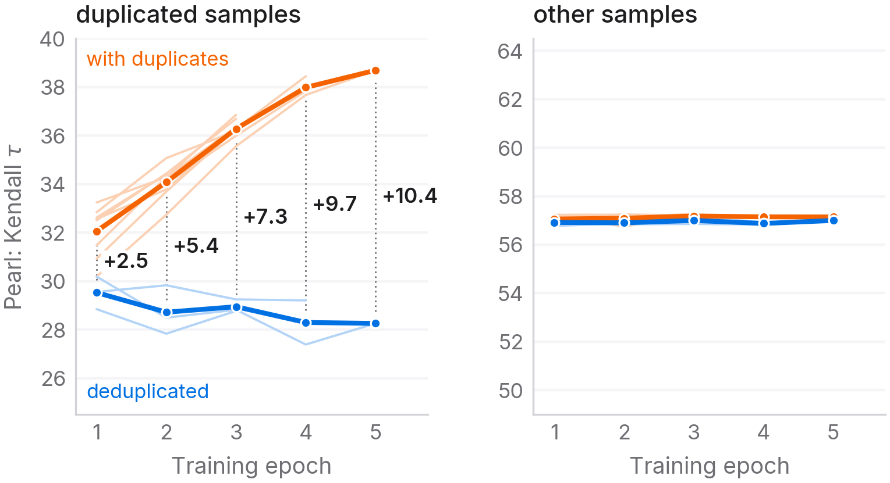
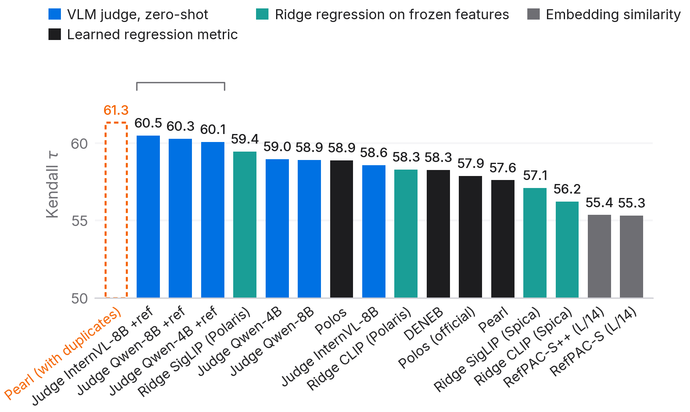
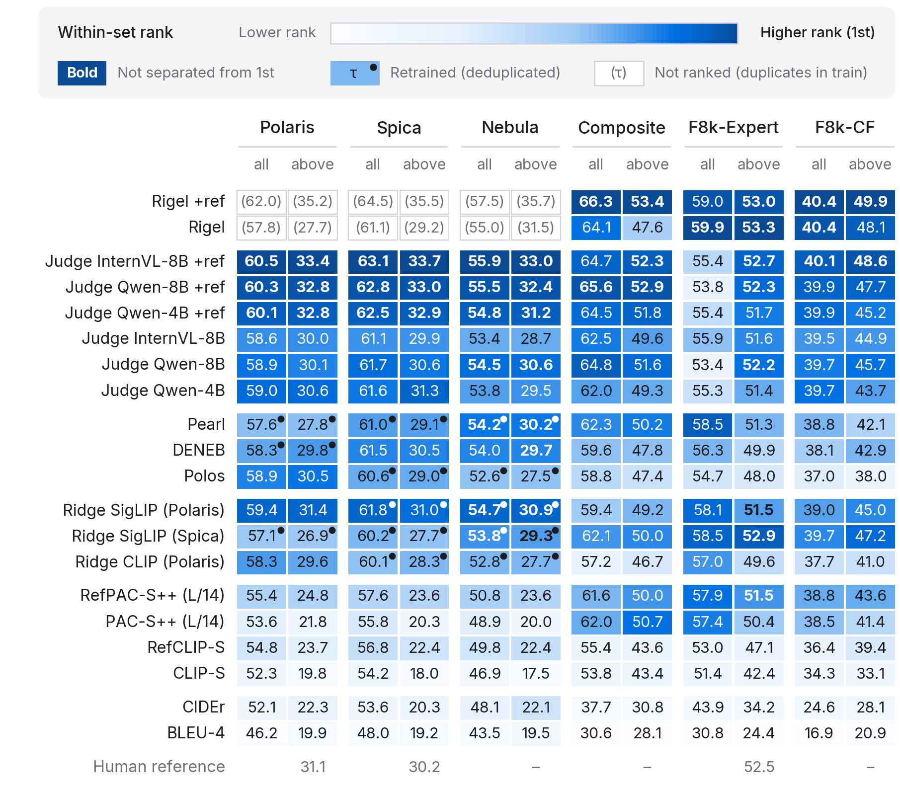

<div align="center">

# Do Learned Image Captioning Metrics Generalize?

### Auditing Duplicated Samples in Human-Judgment Benchmarks

**Xiaochen Zhang** · **Jin Li** · **Chunlong Xia** · **Longjiang Guo**

<p>
  <a href="https://arxiv.org/pdf/2611.30488">
    
  </a>
  <a href="https://huggingface.co/datasets/hutmorning/ic-dataset-audit">
    
  </a>
  <a href="requirements.txt">
    
  </a>
  <a href="LICENSE">
    
  </a>
  <a href="https://creativecommons.org/licenses/by/4.0/">
    
  </a>
</p>

<p>
  <a href="#key-findings">Key Findings</a> ·
  <a href="#1-clean-a-training-set">Clean a Training Set</a> ·
  <a href="#2-reproduce-the-paper">Reproduce Paper</a> ·
  <a href="#hugging-face-artifacts">Hugging Face Artifacts</a> ·
  <a href="#3-rerun-any-stage-gpu">Full Pipeline</a> ·
  <a href="#citation">Citation</a>
</p>

<br>



<p><em>Overview of our audit across Polaris, Nebula, and Spica: (a) cross-dataset sample duplication up to 68%, (b) controlled deduplication experiment separating memorization from generalization, and (c) clean evaluation protocol.</em></p>

</div>

---

Recent human-judgment benchmarks for image captioning (**Polaris**, **Nebula**, and **Spica**) share a large fraction of duplicated `(image, candidate caption)` pairs across their training and test splits—**68.4%** of the Polaris test set appears inside the Spica training set, with identical mean human ratings for **96.7%–100%** of cross-dataset duplicated pairs.

This repository provides:

1. **One-command deduplication** ([`dedup/dedup.py`](dedup/README.md)) to remove leaked test samples from training sets or mark evaluation groups.
2. **CPU verification** (`reproduce.py`) of all **23 tables**, **300 number macros**, and manuscript figures directly from stored per-sample scores.
3. **Full pipeline scripts** to rerun the raw audit, feature caching, model training, and metric scoring from scratch.

> [!NOTE]
> **No dataset redistribution.** This repository and its companion Hugging Face release contain no images, captions, or human ratings from Polaris, Nebula, Spica, Composite, or Flickr8k. Where human scores are needed, `setup_data.py` reads only the score columns from the official releases. (One file, `rows/pascal50s_pairs.json`, records annotator preference indices for PASCAL-50S pairs.)

---

## Key Findings

### 1. Substantial cross-dataset sample leakage

Across the three recent benchmarks, exact `(image, candidate caption)` pairs—matched by decoded pixels and exact candidate text—leak heavily between training and evaluation sets (**68.4%** of Polaris test in Spica train, **50.2%** in Nebula train; **43.3%** of Spica test and **24.4%** of Nebula test in Polaris train; **2.2%** of Spica test inside Spica train itself), with identical pair-mean human ratings on **96.7%–100%** of the cross-dataset duplicates (Appendix B). Earlier benchmarks (Composite, Flickr8k-Expert, Flickr8k-CF) have virtually zero sample overlap.

<p align="center">
  
</p>

### 2. Memorization compounds with every training epoch

Across **Pearl** trainings whose Spica training set retains the duplicates (released, random-removal, and matched-removal runs), the mean gap over deduplicated runs on duplicated Polaris test samples widens from **+2.5** at epoch 1 to **+10.4** at epoch 5—with all three released runs stopping by epoch 3 (**+7.6** over deduplicated) and epoch 5 reflecting the single remaining matched-removal vs. deduplicated run (Appendix F)—while all other samples stay flat across epochs (within ~0.5 points). By contrast, **DENEB** gains less than one point overall (**+0.55**).

<p align="center">
  
</p>

### 3. Re-ranking after deduplication changes who leads

Removing duplicated training samples drops **Pearl** on Polaris from **61.3** (apparent 1st) to **57.6** (rank 12). Under the deduplicated protocol, **zero-shot VLM judges** lead the recent benchmarks, a simple **Ridge regression on frozen SigLIP features** (59.4, rank 4 on Polaris) matches or outperforms Polos, DENEB, and Pearl, and the fine-tuned judge **Rigel** leads the earlier benchmarks.

<p align="center">
  
</p>

<p align="center">
  
  <br>
  <em>Re-ranking across all six benchmarks (100 × Kendall's τ over all samples and over samples above the lowest human score). Bold: statistically tied for 1st. Dot (•): retrained on the deduplicated training set. Parentheses: unranked because only a leaked model exists.</em>
</p>

---

## 1. Clean a Training Set

`dedup/dedup.py` is standalone and requires only `numpy` (plus `pyarrow` for Parquet files and `Pillow` for `clean-any`).

```bash
# Clean released training splits (downloads or reads local copies)
python dedup/dedup.py clean spica_train --download                           # -> cleaned/spica_train_dedup.csv
python dedup/dedup.py clean nebula_train --data /data/Nebula
python dedup/dedup.py clean spica_train --data /data/Spica --variant relaxed # also removes near-duplicates

# Clean any custom mixture by pixel & caption content
python dedup/dedup.py clean-any my_mixture.csv --images /data/images

# Tag evaluation samples as duplicated / image_only / unseen_image (for metrics that cannot be retrained)
python dedup/dedup.py groups polaris_test --data /data/polaris --train spica_train --out groups.csv
```

`clean` verifies every row against a manifest digest before filtering by position; `clean-any` matches by decoded pixel content and works on arbitrary training files. See [`dedup/README.md`](dedup/README.md) for all options.

---

## 2. Reproduce the Paper

| Command | What is verified | Needs | Runtime |
| :--- | :--- | :--- | :--- |
| `python reproduce.py tables` | All 23 tables and 300 number macros against `paper/expected/` | This repository only | ~2 s |
| `python reproduce.py analysis` | All statistical result files from per-sample scores | `per_sample_scores.tar` + `setup_data.py` | ~1 h (CPU) |
| `python reproduce.py figures` | All data-driven manuscript figures | As above | ~20 s |

```bash
pip install -r requirements.txt            # numpy, scipy, matplotlib, pyarrow, pillow (CPU-only)

# Fast check: regenerate all tables & macros from shipped result files
python reproduce.py tables

# Full statistical check: fetch per-sample scores from Hugging Face and rerun all tests
hf download hutmorning/ic-dataset-audit per_sample_scores.tar --repo-type dataset --local-dir .
tar -xf per_sample_scores.tar
python reproduce.py files                  # optional: verify SHA-256 of every unpacked file
python setup_data.py                       # fetch human score columns only (~190 MB, 2–3 min)
python reproduce.py analysis
python reproduce.py figures
```

<details>
<summary><strong>Verification details, step timing, and offline dataset flags</strong></summary>

- **Exact reproducibility**: `reproduce.py analysis` reruns the image-level bootstrap, paired tests, sample-group contrasts, and per-epoch curves with fixed seeds and reports the maximum numerical difference against the shipped JSON files. `reproduce.py tables` compares regenerated `paper/generated/` files byte-for-byte with `paper/expected/`.
- **Parallelism & timing**: The nine steps of `analysis` run concurrently (`--only <step>` runs one step; `--workers N` controls workers for `pairwise`). On a 96-core CPU machine, the full run took 55 minutes (`groups`: 55 min, `pairwise` with 44 workers: 20 min, other steps: 1–25 min).
- **Offline `setup_data.py`**: By default, `setup_data.py` uses HTTP range requests on Parquet files (no images downloaded) and checks every score vector against a SHA-256 digest. To run offline with local copies:
  ```bash
  python setup_data.py --polaris DIR --spica DIR --nebula DIR --composite FILE --flickr8k DIR
  ```
- **Audit counts**: Raw overlap and dataset-structure counts come directly from the datasets (Stage 1 below) and are not recomputed during `reproduce.py analysis`.

</details>

---

## Hugging Face Artifacts

<p>
  <a href="https://huggingface.co/datasets/hutmorning/ic-dataset-audit">
    
  </a>
</p>

Per-sample score archives, checksums, and all 82 retrained MLP checkpoints are hosted on Hugging Face at [`hutmorning/ic-dataset-audit`](https://huggingface.co/datasets/hutmorning/ic-dataset-audit):

| Artifact | Size | Contents |
| :--- | :---: | :--- |
| `per_sample_scores.tar` | 121 MB | Per-sample scores required by `reproduce.py analysis` and `figures` |
| `further_scores.tar` | 411 MB | Extra stored scores (FOIL, PASCAL-50S, validation splits, extra seeds) and fitted ridge weights (`weights.pt`) |
| `checkpoints/mlp_siglip/` | 6.4 GB | 62 best checkpoints (`best.pt`) of Polos-style MLPs on frozen SigLIP features across splits and seeds |
| `checkpoints/mlp_clip/` | 1.3 GB | 20 best checkpoints (`best.pt`) of Polos-style MLPs on frozen CLIP features |
| `SHA256SUMS` | 254 B | SHA-256 digests of the release archives |

<details>
<summary><strong>Unpacked score archive paths & file formats</strong></summary>

| Path | Contents |
| :--- | :--- |
| `runs/probe/models/<model>/<train_set>/predictions/<set>.npy` | Score of every metric, judge, and retrained model on every sample; adjacent `report.json` names the columns |
| `runs/metrics/pearl/<train_set>_s<seed>/epoch_scores/` | Per-epoch scores for all 12 Pearl trainings |
| `runs/metrics/deneb/<train_set>_s<seed>/epoch_scores/` | Per-epoch scores for all 9 DENEB trainings |
| `runs/metrics/vlm/` | InternVL judge (with and without prefilled think block): score, argmax rating, rating-token probabilities |

Rows follow the released order in `rows/<set>.npz` (`ids`). Pixel hashes are stored in `rows/pictures.json`, and per-sample leakage groups in `dedup/manifests/evaluation_<set>.npz`. See [`docs/formats.md`](docs/formats.md) for schemas.

</details>

---

## 3. Rerun Any Stage (GPU)

Rerunning from raw datasets requires the official dataset files and (from Stage 2 onward) a GPU. Set `CAPAUDIT_ROOT` if running outside the repository root. Full execution order, script index, and per-environment package lists are documented in [`docs/pipeline.md`](docs/pipeline.md), [`docs/scripts.md`](docs/scripts.md), and [`docs/environments/`](docs/environments/).

| Stage | Scripts | Hardware |
| :--- | :--- | :---: |
| 1. Audit (pixel hashes, overlap, structure, near-duplicates) | `analysis/audit/`, `analysis/summary/structure.py`, `analysis/metrics/near_duplicates.py` | CPU |
| 2. Row files & frozen features | `Polos-revised/revision/cache_features.py`, `analysis/probe/build_cache_v2.py` | GPU |
| 3. Ridge, MLP probes & cross-fitting | `analysis/probe/` | GPU |
| 4. Model training (12 Pearl + 9 DENEB, 3 seeds each) | `analysis/metrics/run_pearl.sh`, `analysis/metrics/run_deneb.sh` | GPU (~5–7 h/Pearl on RTX 4090) |
| 5. Scoring (overlap, CLIP-S, PAC-S, Polos, DENEB, Pearl, Rigel, VLM judges) | `analysis/metrics/score_*.py` | GPU |
| 6. Statistics | `reproduce.py analysis` | CPU |
| 7. Tables, number macros & figures | `reproduce.py tables`, `reproduce.py figures` | CPU |

Upstream commits and patches live in `external_patches/`: DENEB and Rigel are unmodified; Pearl is patched to skip unused image decoding and load feature files once per process; Polos adds full-set evaluation and a SigLIP encoder (`Polos.patch` + `Polos-revised/revision/`).

---

## Reference Details

<details>
<summary><strong>Repository layout</strong></summary>

```text
assets/                Figures shown in this README
dedup/                 Standalone dedup.py and filter manifests
reproduce.py           CPU verification of files, statistics, tables, and figures
setup_data.py          Fetches human score columns from official dataset releases
rows/                  Score-free row indices and image pixel hashes
runs/                  Shipped JSON results (repo) and per-sample scores (HF archive)
analysis/audit/        Cross-dataset sample and image overlap audit
analysis/probe/        Ridge/MLP models on frozen features and shared statistics code
analysis/metrics/      Training, scoring, and ranking protocol for public metrics
analysis/summary/      Sample groups, Kendall's tau decomposition, and case studies
analysis/thirdparty/   Audit of training files released with EXPERT
paper/                 make_tables.py, figure scripts, and expected LaTeX outputs
external_patches/      Pinned upstream commits and minimal patches
docs/                  Pipeline guide, script index, file formats, and environment pins
```

</details>

<details>
<summary><strong>Datasets and pinned revisions</strong></summary>

| Dataset | Official Source | Pinned Revision |
| :--- | :--- | :---: |
| Polaris | `yuwd/Polaris` (Hugging Face) | `e527aa8` |
| Nebula | `Ka2ukiMatsuda/Nebula` (Hugging Face) | `a4c99b1` |
| Spica | `hiranohachiman/Spica` (Hugging Face) | `c382725` |
| Composite | `yuwd/Composite` (Hugging Face) | `d6c63cb` |
| Flickr8k-Expert & CF | PAC-S prepared files (`hjkim811/EXPERT` on GitHub) | `7fbfb00` |

Filter manifests in `dedup/manifests/` and digests in `rows/index.json` are pinned to these revisions. If an upstream dataset changes, `dedup.py clean` refuses the modified file; `clean-any` still works by content.

</details>

---

## License

- **Code**: [MIT License](LICENSE) (`Polos-revised/revision/` builds on Polos under the Clear BSD License).
- **Filter manifests, row indices, result files, and Hugging Face artifacts**: [CC BY 4.0](https://creativecommons.org/licenses/by/4.0/).
- **Fonts** (`paper/fonts/`): Inter (SIL Open Font License).

## Citation

```bibtex
@misc{zhang2026icdatasetaudit,
  title  = {Do learned image captioning metrics generalize? Auditing duplicated samples in human-judgment benchmarks},
  author = {Xiaochen Zhang and Jin Li and Chunlong Xia and Longjiang Guo},
  year   = {2026},
  url    = {https://github.com/morninghut/ic-dataset-audit}
}
```
